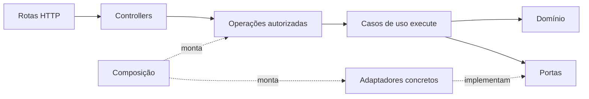

# Arquitetura do EntreAulas

A [ADR 0017](../adr/0017-refatoracao-arquitetural.md) registra a refatoração baseada em NodeVue e cccat24_8. O produto continua sendo um monólito modular com API e worker separados pelo perfil de execução.

## Responsabilidades

| Local                                                     | Responsabilidade                                                                    |
| --------------------------------------------------------- | ----------------------------------------------------------------------------------- |
| `packages/core/src/modules/<module>/domain`               | Estados, entidades, erros e funções puras de negócio                                |
| `packages/core/src/modules/<module>/application/usecases` | Classes com `execute`, uma por operação, agrupadas por agregado (`subjects.ts`)     |
| `packages/core/src/modules/<module>/application/queries`  | Consultas de leitura próprias, fora de um agregado (por exemplo, auditoria)         |
| `packages/core/src/modules/<module>/application/services` | Apoio compartilhado entre casos de uso do módulo, como leitura e gravação da grade  |
| `packages/core/src/modules/<module>/application/ports`    | Interfaces definidas pelo consumidor                                                |
| `packages/infrastructure/src/modules/<module>`            | Repositórios e adaptadores de persistência e segurança                              |
| `packages/contracts/src/modules/<module>`                 | Schemas e tipos públicos de transporte                                              |
| `apps/api/src/composition`                                | Montagem explícita dos casos de uso e da autorização                                |
| `apps/api/src/controllers`                                | Chamadas às operações protegidas e tradução de resultados                           |
| `apps/api/src/http`                                       | Validação de entrada, rotas, status, cookies e hooks do Fastify                     |
| `apps/worker/src/composition`                             | Montagem do consumidor, executor, logger e heartbeat                                |
| `apps/worker/src/consumers`                               | Reserva, renovação, cancelamento e entrega dos resultados da fila                   |
| `apps/web/src/app`                                        | Montagem do Vue, transporte, serviços, sessão e roteador                            |
| `apps/web/src/modules/<module>`                           | Interfaces em `application`, HTTP em `infra`, telas e composables em `presentation` |

## Entidades e fotografias

Entidades como `SubjectEntity`, `TeacherEntity` e `PlanningRevisionEntity` concentram transições de negócio. `create` aplica as regras de criação; `reconstitute` recupera o estado persistido sem redefinir identidade, versão e datas; `snapshot` devolve uma cópia independente para persistência ou tradução.

Os repositórios recebem e devolvem os estados serializáveis tipados. Isso permite manter fotografias históricas, propostas do motor e DTOs separados dos objetos com comportamento. As funções puras de domínio continuam apropriadas para algoritmos de validação e busca. Transições existem só na entidade: casos de uso, fixtures e testes usam `XEntity.create(...).snapshot()` ou `XEntity.reconstitute(estado).<transição>().snapshot()`, sem funções paralelas.

## Composição e transações

Os casos de uso recebem um objeto de dependências pelo construtor, guardado em `readonly #deps` e tipado como `<CasoDeUso>Dependencies` com somente as portas usadas. `bindUseCase` preserva o contexto de `execute` ao adaptar uma classe para as funções usadas pela fronteira de autorização. Quando o contrato público reúne várias operações em um campo, como `operation` em `ChangePlanning`, uma classe apenas encaminha cada valor ao caso de uso correspondente.

`composeOperations` cria os conjuntos de operações com os adaptadores do cliente transacional recebido da unidade de trabalho; há uma função de composição por área (`catalog.ts`, `planning.ts` e `access.ts`). A operação pública passa por `makeAuthorizedOperation`, que verifica a sessão e os papéis. Escritas, auditoria e incremento da versão do catálogo continuam na mesma transação, com o bloqueio `app_state`. Controllers recebem essas operações já protegidas.

Cada operação do catálogo é classificada em `CATALOG_ACCESS` como leitura ou escrita. O tipo exige todas as chaves de `composeCatalog`, então uma operação nova não compila sem a classificação; escritas são auditadas como `catalog.<operação>`.

O login é composto uma vez por aplicação para preservar seu limite de verificações simultâneas. Suas portas separam senhas, tokens, relógio e armazenamento. O adaptador confere novamente a versão e o estado da conta ao gravar a sessão e a auditoria atomicamente.

No worker, `GenerationConsumer` depende das portas de fila, execução e log. `ThreadGenerationExecutor` mantém o cálculo isolado; a thread compõe `GenerateTimetable` com `ReferenceTimetableEngine`. O validador continua independente do algoritmo de busca.

## Fronteiras públicas

- Dentro do core, outro módulo é acessado por `domain/index.ts` ou `application/ports/index.ts`, conforme a camada. O índice completo do módulo atende os apps e demais consumidores externos. Um arquivo de domínio não importa a aplicação nem o índice completo de outro módulo.
- Na web, `application/index.ts` publica as interfaces. A apresentação pode usar o índice público de outro módulo para chaves, tipos e componentes. A composição do app é o ponto que conhece as implementações HTTP, todas fábricas `create<Serviço>Api(client)`.
- Na infraestrutura, cada `modules/<module>/index.ts` lista explicitamente os adaptadores públicos, e o índice do pacote os reúne.
- `shared` reúne elementos independentes dos módulos de negócio. Componentes genéricos recebem dados e permissões explicitamente.
- Código de produção não importa `testing`; ali ficam repositórios em memória, fixtures e montagem de operações para testes.

Essas regras são verificadas por `pnpm check:arch`. Os testes de arquitetura também executam o dependency-cruiser sobre projetos temporários para provar a rejeição das dependências proibidas.

## Interface e ciclo de vida

O transporte HTTP é injetado nos serviços e valida respostas com os contratos Zod. A sessão reativa pertence ao módulo de acesso e é injetada no roteador; não há uma instância global de cliente ou sessão em produção.

As páginas de grade, geração e atribuições usam composables para coordenar carregamento, comandos, feedback e estado de apresentação. O acompanhamento da geração para ao desmontar, inclusive quando uma resposta pendente chega depois. A mudança do caminho remonta a página; a seleção de revisão na grade acompanha a query da rota.

## Acrescentar um fluxo

1. Definir regras no domínio e uma porta pequena no módulo consumidor.
2. Criar o caso de uso com `execute` e testar seu comportamento com dependências inventadas.
3. Implementar o adaptador, mantendo versão otimista, identidades e garantias do banco.
4. Montar a operação na composição transacional e protegê-la antes de passá-la ao controller.
5. Definir ou atualizar os contratos, validar a entrada HTTP e traduzir resultados para DTOs.
6. Injetar o serviço na interface e manter estados de carregamento, erro, vazio e confirmação.
7. Executar as suítes, conferir a tela a 375 px e seguir a verificação de nomes e o processo de entrega do `AGENTS.md`.
