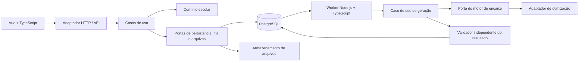
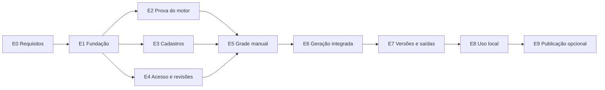

# Plano de desenvolvimento — Organizador de Aulas

**Nome provisório:** EntreAulas  
**Versão do plano:** 1.0  
**Data:** 22/10/2026  
**Status:** planejamento técnico para implementação futura; nenhum código de aplicação entregue nesta etapa.

## 1. Objetivo e resultado esperado

Criar uma aplicação web para a secretaria escolar distribuir cargas de professores e montar a grade semanal, respeitando indisponibilidades, cargas curriculares e demais regras da escola.

A secretaria deverá conseguir preparar os dados, gerar horários automaticamente, entender pendências, fazer ajustes manuais, preservar aulas aprovadas, comparar versões e exportar a grade. O planejamento de um ano poderá ser reutilizado no seguinte.

O protótipo navegável já apresentado é uma referência de experiência e fluxo. Seus dados são fictícios e sua geração é simulada. A implementação definitiva terá persistência, validação no servidor e mecanismo real de busca.

### 1.1 Decisões estabelecidas

| Tema | Diretriz |
| --- | --- |
| Front-end | Vue com TypeScript |
| Back-end | Node.js com TypeScript |
| Linguagem do código da aplicação | TypeScript com configuração estrita |
| Banco | PostgreSQL |
| Arquitetura | Clean Architecture e Ports and Adapters em monólito modular |
| Princípios | SOLID aplicado quando melhorar coesão, clareza e substituição de dependências |
| Ambiente | Docker e Docker Compose; execução local como caminho inicial completo |
| Testes | Unitários, integração e ponta a ponta automatizados desde as primeiras entregas |
| Hospedagem futura | Preparar para implantação híbrida com front-end na Vercel; publicação é opcional |
| Repositório | Será preparado pelo usuário; este plano não cria remoto nem configura publicação |

### 1.2 Duas distribuições diferentes

1. **Distribuição de responsabilidade:** decidir qual professor assume cada disciplina e turma. No escopo inicial, a secretaria escolhe entre os professores habilitados, com validação de carga e disponibilidade.
2. **Distribuição de horários:** encontrar dias e períodos para as aulas já atribuídas. Esta será automática na primeira versão utilizável, com ajustes manuais posteriores.

A escolha automática do professor responsável por uma turma fica para evolução posterior, salvo se o levantamento mostrar que é indispensável. Ela exige regras adicionais de elegibilidade, prioridades, contratos e distribuição de carga.

## 2. Escopo funcional

### 2.1 Incluído no primeiro produto utilizável

- Uma escola, com usuários da secretaria e da coordenação.
- Planejamentos por ano letivo e período de vigência.
- Semana recorrente, dias letivos, turnos, períodos e intervalos configuráveis.
- Professores, disciplinas, habilitações, turmas e cargas semanais.
- Disponibilidade por professor, dia e faixa de horário; edição de dia inteiro.
- Estados distintos: disponível, indisponível e prefere evitar.
- Distribuição de professores e cargas por disciplina/turma.
- Regras obrigatórias e preferências com prioridades.
- Diagnósticos de dados incompletos ou claramente incompatíveis antes da geração.
- Geração automática assíncrona, com limite de tempo, consulta de estado e cancelamento.
- Grade por turma, professor e visão geral com filtros.
- Movimentação e troca de aulas com validação no servidor.
- Fixação de aulas e nova geração preservando essas escolhas.
- Versões, comparação de alterações, restauração e trilha de auditoria.
- Conclusão da grade somente com todas as regras obrigatórias atendidas.
- Impressão/PDF, exportação XLSX e importação de cadastros/cargas em modelo CSV.
- Cópia do planejamento anterior com revisão explícita de disponibilidades e cargas.
- Login, permissões, backup e restauração documentados.

### 2.2 Itens que dependem do levantamento

| Item | Decisão necessária antes de desenvolver o motor |
| --- | --- |
| Salas, laboratório, quadra e outros recursos | Controlar apenas se representam restrição real para a escola |
| Aulas duplas ou triplas | Definir duração, consecutividade e possibilidade de atravessar intervalos |
| Professores em vários turnos | Definir horários reais e restrições entre turnos |
| Deslocamento entre prédios | Definir tempo mínimo necessário entre aulas |
| Turmas divididas, grupos e aulas conjuntas | Confirmar se são essenciais; alteram o modelo de conflitos |
| Dois professores na mesma aula | Confirmar se há necessidade de docência compartilhada |
| Reuniões e atividades fixas | Definir quais ocupam a agenda do professor ou da turma |
| Janelas dos alunos | Identificar períodos em que cada turma obrigatoriamente deve estar em aula |

Se algum desses itens for indispensável, deverá entrar no modelo e na prova técnica inicial. Não será adiado para depois da implementação do gerador.

### 2.3 Fora do escopo inicial

- Substituições diárias por faltas e gestão de frequência.
- Notas, matrículas, financeiro ou outros módulos de gestão escolar.
- Portal de professores para negociação de disponibilidade.
- Notificações automáticas por e-mail ou aplicativos de mensagens.
- Produto comercial com várias escolas e cobrança de assinaturas.
- Calendários alternados de duas semanas, salvo necessidade confirmada na entrega E0.
- Importação direta do formato proprietário do aSc sem verificar arquivos e documentação.
- Uso de modelos de linguagem como mecanismo responsável por montar ou validar a grade.

## 3. Arquitetura proposta

### 3.1 Monólito modular, API e worker

O projeto terá uma base de código organizada por módulos de negócio, com dois processos de back-end: API HTTP e worker de tarefas. Os dois reutilizam os mesmos casos de uso e regras. Separar o processo de geração evita que cálculos intensivos bloqueiem requisições da interface.

Não serão criados microserviços por entidade. A separação de processos serve ao perfil de execução; não implica distribuir o domínio entre vários serviços independentes.



O diagrama representa o fluxo de execução. No código, o sentido de dependência é sempre de infraestrutura para as interfaces e regras internas, conforme descrito a seguir.

### 3.2 Camadas e regras de dependência

| Camada | Responsabilidade | Dependências permitidas |
| --- | --- | --- |
| Domínio | Entidades, objetos de valor, invariantes e regras da grade | TypeScript e utilitários puros estritamente necessários |
| Aplicação | Casos de uso, autorização de negócio, transações e portas | Domínio |
| Adaptadores de entrada | HTTP, comandos administrativos e consumo de tarefas | Aplicação e contratos de transporte |
| Adaptadores de saída | PostgreSQL/ORM, fila, arquivos, relógio, autenticação e motor | Interfaces internas e bibliotecas específicas |
| Composição | Instanciar e conectar implementações | Todas as camadas necessárias |
| Apresentação | Componentes Vue, estado de tela e interação | Contratos da API e serviços do front-end |

Regras obrigatórias de organização:

- O domínio não importa Vue, Fastify, Prisma, drivers de banco ou APIs da Vercel.
- Modelos do ORM e objetos HTTP não são entidades de domínio.
- Controllers validam entrada, chamam casos de uso e traduzem respostas; não montam horários.
- Componentes podem antecipar avisos, mas o servidor valida toda alteração relevante.
- A composição injeta dependências explicitamente, sem exigir um contêiner de injeção.
- Portas existem para fronteiras reais ou substituições úteis; não haverá uma interface para toda classe.
- Funções puras são preferidas para cálculos e regras sem estado; classes são usadas quando fizerem sentido.
- Transações são controladas por casos de uso através de uma porta, sem expor o cliente do ORM.
- Verificações estáticas de imports impedirão dependências proibidas e ciclos entre módulos.

### 3.3 Aplicação prática de SOLID

- **Responsabilidade única:** separar validação, busca de horários, persistência e apresentação de diagnósticos.
- **Aberto/fechado:** adicionar tipos de regra e adaptadores sem espalhar condicionais pela aplicação. Criar a extensão quando existir uma necessidade concreta.
- **Substituição:** adaptadores de persistência, armazenamento e motor devem cumprir contratos verificáveis.
- **Segregação:** portas pequenas orientadas aos casos de uso, evitando repositórios genéricos com dezenas de operações.
- **Inversão de dependência:** o caso de uso define o contrato de que precisa; infraestrutura o implementa.

### 3.4 Stack de referência

| Área | Escolha proposta |
| --- | --- |
| Interface | Vue, Vite, Vue Router e TypeScript |
| Estado de interface | Pinia apenas para estado compartilhado; estado local nos componentes quando suficiente |
| API | Fastify com TypeScript, API REST versionada e contrato OpenAPI |
| Validação de fronteira | Zod ou JSON Schema; escolher uma abordagem em ADR e evitar esquemas concorrentes |
| Persistência | Prisma isolado nos adaptadores; SQL explícito para necessidades específicas do PostgreSQL |
| Fila | pg-boss como candidato inicial, utilizando PostgreSQL |
| Unitários e integração | Vitest |
| Componentes | Vue Test Utils e Testing Library conforme o tipo de interação |
| Banco nos testes | PostgreSQL real em Testcontainers ou serviço isolado de CI |
| Ponta a ponta | Playwright com testes escritos em TypeScript |
| Qualidade | ESLint, formatação consistente, TypeScript strict e verificação de fronteiras |
| Workspace | pnpm workspaces; monorepo sem ferramenta adicional de orquestração até ser necessária |
| Empacotamento | Dockerfiles multi-stage e Docker Compose |

As escolhas propostas serão registradas na E1 com versões compatíveis, suportadas e fixadas em lockfile. A escolha do motor de encaixe permanece condicionada à E2. A fila também precisa passar por teste de transação, recuperação de falha e compatibilidade com o ambiente escolhido.

### 3.5 Estrutura prevista do repositório

```text
apps/
  web/                         # Aplicação Vue
  api/                         # Entrada HTTP e composição da API
  worker/                      # Entrada de tarefas e composição do worker
packages/
  core/
    src/modules/
      school-structure/        # Calendário semanal, turmas, disciplinas e recursos
      teaching/                # Professores, habilitações, disponibilidades e cargas
      timetable/               # Grade, regras, validação e ajustes
      generation/              # Execuções e aplicação de propostas
      planning/                # Revisões, versões e conclusão
      access/                  # Políticas de acesso
    # Dentro de cada módulo: domain/, application/ e portas necessárias
  infrastructure/              # Adaptadores concretos, organizados por responsabilidade
  contracts/                   # DTOs e esquemas públicos da API; sem detalhes do ORM
  test-support/                # Fábricas e utilitários de testes
tests/
  e2e/
  architecture/
  benchmarks/
infra/
  docker/
docs/
  adr/
  product/
  operations/
  testing/
```

Essa árvore é uma orientação; diretórios serão criados quando houver conteúdo. Módulos não acessarão tabelas uns dos outros livremente. Casos de uso coordenadores usarão interfaces explícitas e transações quando necessário.

## 4. Modelo de domínio e persistência

### 4.1 Conceitos principais

| Conceito | Conteúdo principal |
| --- | --- |
| Escola | Identidade, configurações e fuso horário |
| Planejamento | Ano, vigência, estado e revisão atual |
| Estrutura semanal | Dias letivos, turnos e períodos com início/fim reais |
| Professor | Identidade, disciplinas habilitadas e limite de carga |
| Disponibilidade | Bloqueios e preferências vinculados ao planejamento |
| Turma | Identidade, turno e períodos obrigatórios de ocupação |
| Disciplina | Identidade e regras curriculares aplicáveis |
| Atribuição de ensino | Turma, disciplina, professor responsável e carga exigida |
| Recurso | Sala ou equipamento de ocupação exclusiva, se necessário |
| Regra | Tipo, alvo, parâmetros, obrigatoriedade, prioridade e versão |
| Aula alocada | Atribuição, dia, início/fim, recurso e eventual fixação |
| Execução de geração | Snapshot de entrada, motor/versão, parâmetros, estado e resultado |
| Versão da grade | Conjunto consistente de aulas e referência às regras/dados utilizados |
| Auditoria | Autor, ação, instante, revisão e alterações relevantes |

A carga semanal será expressa em unidades de aula, com duração definida pela estrutura escolar. Se houver durações diferentes, a equivalência entre unidades e minutos deverá ser definida na E0. Não somar períodos de durações diferentes como se fossem equivalentes sem uma regra explícita.

### 4.2 Regras de persistência

- PostgreSQL é a fonte oficial dos dados; estado no navegador é uma representação temporária.
- Usar chaves estrangeiras, unicidade, checks e índices para as invariantes representáveis no banco.
- Não excluir fisicamente registros referenciados por versões históricas; arquivar ou criar revisões.
- Usar transações na troca de aulas, aplicação de proposta, restauração e conclusão.
- Registrar revisão numérica para controle otimista de concorrência; alterações baseadas em versão antiga retornam conflito explícito.
- Usar horário local para a grade semanal e UTC para eventos de auditoria. Conversões de exibição usam o fuso da escola.
- Comparar início/fim reais para detectar choque entre turnos com numeração de aulas diferente.
- Cada geração captura uma revisão imutável dos dados. Não consulta dados mutáveis a cada passo da busca.
- Aplicar uma proposta exige conferir a revisão de origem. Se os dados mudaram, a proposta fica desatualizada e exige nova validação ou nova execução.
- A versão concluída é preservada; uma alteração posterior cria um novo rascunho.
- JSONB pode guardar snapshots e parâmetros versionados; relacionamentos e cadastros centrais permanecem estruturados.
- As operações de fila e registro da execução precisam de atomicidade. Preferir transação suportada pelo adaptador; se não for viável, implementar outbox transacional, com teste de recuperação.

## 5. Motor de encaixe e geração automática

### 5.1 Decisão técnica a comprovar

O código próprio do front-end, API, worker, validação e contratos será TypeScript. Não se assume a inclusão de um serviço Python neste plano.

A E2 deverá avaliar uma implementação de referência em TypeScript e, se necessário, bibliotecas de otimização com integração Node.js/WASM ou binário externo mantido. A decisão deve considerar licença, manutenção, desempenho, distribuição em Docker, cancelamento e resultados reproduzíveis.

O OR-Tools mencionado no estudo inicial possui interfaces oficiais documentadas para C++, Python, Java e C#, sem uma interface oficial TypeScript apresentada nesse catálogo. Portanto, não será tratado como uma dependência Node.js pronta. Uma eventual proposta de componente próprio em outra linguagem será uma revisão explícita de arquitetura e escopo, com evidências da E2. [Instalação oficial do OR-Tools](https://developers.google.com/optimization/install).

Uma implementação heurística que funciona no exemplo pequeno não comprova viabilidade para uma escola. O avanço para a integração completa depende do resultado dos benchmarks definidos na E0.

### 5.2 Contrato funcional do motor

**Entrada:** snapshot consistente de cargas, professores, disponibilidades, períodos, regras e aulas fixadas; limite de tempo; semente quando aplicável; critérios de qualidade e versão da modelagem.

**Saída:** proposta de grade quando houver, métricas de preferências, tempo de execução, motivo da parada e diagnósticos tecnicamente sustentados.

Estados distintos do resultado:

- Solução válida encontrada, sem alegar que é a melhor possível.
- Ótimo comprovado, somente quando o algoritmo fornecer essa garantia.
- Inviabilidade comprovada, somente quando houver prova ou diagnóstico suficiente.
- Busca inconclusiva: tempo ou recursos esgotados sem solução nem prova de impossibilidade.
- Cancelada.
- Falha técnica ou modelo inválido, separada de inviabilidade escolar.

Uma proposta parcial pode ajudar o diagnóstico, mas permanece rascunho e nunca é apresentada como grade completa.

### 5.3 Ordem de prioridade

1. Satisfazer todas as restrições obrigatórias e alocar a carga exigida.
2. Preservar fixações explícitas.
3. Em replanejamentos, reduzir alterações em aulas já aceitas, de acordo com a prioridade escolhida.
4. Melhorar preferências: janelas, distribuição por dia e horários a evitar.

Fixações são restrições obrigatórias. O motor não pode desbloqueá-las para obter uma solução. Preferências serão modeladas por níveis ou pesos documentados, sem permitir que uma combinação de benefícios compense uma violação obrigatória.

### 5.4 Segurança do resultado e diagnóstico

- Validar disponibilidade, elegibilidade, sobreposição, recursos, carga exata e fixações fora do motor de busca.
- O validador independente compartilha os conceitos de domínio, mas não confia nas marcações de sucesso do adaptador.
- Revalidar tanto propostas automáticas quanto mudanças manuais e a conclusão final.
- Fazer pré-checagens de capacidade, carga, campos ausentes e regras contraditórias evidentes.
- Explicar conflitos com nomes, turmas e períodos; não mostrar apenas códigos técnicos.
- Não prometer explicar o conjunto mínimo de causas de toda inviabilidade; diagnósticos avançados podem evoluir após o MVP.

### 5.5 Execução em segundo plano

- API registra a solicitação e retorna um identificador; o cálculo não fica preso à requisição HTTP.
- Fila durável em PostgreSQL; começar com um worker e concorrência limitada para tarefas intensivas.
- Caso a busca seja implementada em TypeScript, executar o trabalho intensivo em thread/processo filho controlado pelo worker.
- Guardar heartbeat, tentativa, lease e timestamps; identificar e recuperar tarefas abandonadas.
- Processamento idempotente: uma repetição não cria duas versões nem aplica o resultado duas vezes.
- Retry apenas para falhas transitórias. Inviabilidade e busca inconclusiva não disparam ciclos automáticos infinitos.
- Cancelamento cooperativo e encerramento forçado após prazo definido; resultados tardios não substituem execução cancelada.
- Interface acompanha estado por polling inicialmente. Exibir etapas/tempo, sem inventar percentual de uma busca sem progresso mensurável.
- Resultado gera uma proposta separada. A secretaria compara e aplica explicitamente; a grade atual permanece disponível durante a busca.

## 6. Execução local, Docker e hospedagem futura

### 6.1 Ambiente local completo

O uso local precisa funcionar sem conta em um provedor de hospedagem, inclusive sem conexão com a internet após instalação das imagens e dependências.

Serviços previstos no Compose:

- `web`: interface compilada e servidor HTTP/proxy no perfil de uso; Vite no perfil de desenvolvimento.
- `api`: API Node.js.
- `worker`: consumidor de tarefas e geração.
- `postgres`: banco com volume persistente.
- Processo de migração executado uma vez antes de disponibilizar a aplicação.

Requisitos operacionais:

- Dockerfiles multi-stage, versões fixadas, processos sem root quando suportado e healthchecks.
- `.env.example` sem segredos; validação de configuração na inicialização.
- Separar desenvolvimento, testes e uso local; bases e volumes de teste nunca apontam para dados reais.
- Publicar a interface em localhost por padrão. Acesso pela rede local exige configuração deliberada de endereço, autenticação e transporte.
- Banco sem porta pública por padrão no perfil de uso; worker não exige endpoint público.
- Shutdown gracioso, logs estruturados e limite de memória/CPU compatível com o computador da escola.
- Seed demonstrativo opcional, separado da criação inicial de usuários e dados reais.
- Backup fora do volume do PostgreSQL, com retenção e teste de restauração. Volume persistente não substitui backup.
- Documentar instalação no Windows com Docker Desktop/WSL2 e em Linux; confirmar suporte pela matriz de testes.

### 6.2 Publicação futura

| Cenário | Distribuição |
| --- | --- |
| Somente local | Toda a aplicação via Compose no computador/servidor da escola |
| Servidor com Docker | Web, API e worker em containers; PostgreSQL local ao servidor ou gerenciado |
| Híbrido com Vercel | Front-end na Vercel; API e worker em ambiente que execute processos persistentes; PostgreSQL acessível a esses serviços |
| API também na Vercel | Avaliação opcional após o MVP; adaptador compatível, pooling e limites de execução verificados; worker continua fora da requisição |

Vercel Functions possui limites de execução. A arquitetura não dependerá de manter uma busca longa ou um daemon ativo dentro de uma função HTTP. Os limites, runtimes e recursos disponíveis devem ser reconferidos na etapa de publicação, sem fixar neste plano valores de um plano comercial. [Limites oficiais](https://vercel.com/docs/functions/limitations).

Não se presume que um arquivo Docker Compose seja diretamente implantável na Vercel. Docker resolve os ambientes locais e os serviços em infraestrutura de containers; a Vercel terá sua configuração própria caso seja escolhida.

O navegador não acessará PostgreSQL diretamente. Na nuvem, arquivos exportados usam armazenamento durável através de uma porta; não se depende do disco temporário de funções. Preferir mesmo domínio com proxy para a API; se houver origens diferentes, definir cookies, CORS e proteção CSRF coerentemente.

## 7. Entregas faseadas

Cada entrega terá incremento demonstrável, testes proporcionais, documentação atualizada e critérios de aceite. A aprovação de experiência ocorre com a usuária; decisões técnicas e resultados de testes ficam registrados no repositório.

### E0 — Requisitos reais e contrato do MVP

**Dependência:** nenhuma.  
**Objetivo:** transformar o trabalho da secretaria em regras e exemplos verificáveis.

Entregar:

- Inventário de professores, turmas, turnos, cargas e restrições necessárias.
- Glossário, fluxos e histórias de usuário com critérios de aceite.
- Classificação de cada regra como obrigatória ou preferencial.
- Confirmação dos itens condicionais da seção 2.2.
- Ajustes necessários no protótipo e mapa das telas do MVP.
- Dataset pequeno conhecido, dataset representativo anonimizado e casos inviáveis.
- Matriz de benchmark: volume real, cenário de crescimento, hardware, limite de tempo e memória.
- Definição de papéis e processo de conclusão da grade.

**Aceite:** a esposa confirma que os dados, regras e fluxo representam sua rotina; todos os requisitos obrigatórios possuem exemplo de teste. Metas de tempo de geração são registradas antes da prova técnica.

### E1 — Fundação técnica e ambiente reproduzível

**Dependência:** E0 e repositório limpo disponibilizado pelo usuário.

Entregar:

- Workspace TypeScript, aplicação Vue mínima, API e entrada do worker.
- Estrutura de domínio/aplicação/adaptadores e primeiro caso de uso vertical simples.
- PostgreSQL, migrações, Compose, healthchecks e configuração de ambientes.
- Scripts de desenvolvimento, build, lint, typecheck e testes.
- CI com instalação pelo lockfile, análise estática, testes iniciais e build.
- ADRs da arquitetura, stack, persistência e estratégia de fila.
- README de instalação e exemplos de configuração.

**Testes:** caso de uso puro, persistência real em PostgreSQL, healthcheck HTTP e teste E2E de abertura da aplicação.

**Aceite:** um checkout novo sobe seguindo o README; CI passa; domínio não depende de infraestrutura; nenhuma credencial real é necessária para a demonstração local.

### E2 — Prova técnica do motor de encaixe

**Dependência:** E0 e base mínima da E1.  
**Objetivo:** reduzir o principal risco antes de construir a maior parte da interface.

Entregar:

- Contrato do motor, modelagem das restrições essenciais e validador independente.
- Implementação de referência e avaliação de alternativas quando necessário.
- Suporte demonstrado a indisponibilidade, carga exata, conflitos e fixações.
- Encerramento por tempo, cancelamento e diferenciação dos estados de resultado.
- Relatório de correção, tempo, memória e qualidade por dataset.
- ADR escolhendo o adaptador e registrando limites conhecidos.

**Testes:** soluções conhecidas; entradas impossíveis; solução inválida rejeitada pelo validador; repetibilidade dos casos pequenos; timeout; cancelamento; fixações preservadas; restrições entre turnos.

**Aceite:** obter soluções válidas no conjunto representativo dentro das metas pactuadas e não produzir falsos sucessos. Se o benchmark falhar, revisar motor, escopo ou metas antes de E6. O exemplo de três turmas do protótipo não é suficiente para aprovar esta entrega.

### E3 — Cadastros, disponibilidades e distribuição de cargas

**Dependências:** E1; regras estruturais da E0 estabilizadas.

Entregar:

- CRUD de professores, habilitações, disciplinas, turmas, turnos e períodos.
- Disponibilidade por dia/período com legenda textual e edição em lote.
- Atribuição de professor por disciplina/turma e conferência da carga.
- Configuração dos recursos especiais confirmados no levantamento.
- Validações de duplicidade, referências, duração e limites de carga.
- Arquivamento seguro de cadastros que já participam de planejamentos.
- Estados de carregamento, vazio, erro, edição pendente e confirmação de salvamento.

**Testes:** regras de disponibilidade/carga; persistência e transações; fluxo E2E cadastrar → atribuir → salvar → recarregar.

**Aceite:** a secretaria cadastra um planejamento representativo e volta a encontrá-lo após reiniciar a aplicação, sem perda de dados.

### E4 — Acesso, revisões e integridade dos planejamentos

**Dependência:** E1; integrar com E3 antes de usar dados reais.

Entregar:

- Login e sessões persistidas; criação inicial de administrador por procedimento seguro.
- Papéis de administrador, editor e consulta, conforme E0.
- Autorização nos casos de uso, sem depender de esconder botões.
- Revisões, rascunhos, trilha de auditoria e controle de concorrência.
- Cópia de planejamento e tratamento de regras/disponibilidades ainda não revisadas.
- Política de exclusão/arquivamento e de acesso às exportações.

**Testes:** autenticação, autorização por operação, sessão expirada, acesso indevido por identificador e duas sessões editando a mesma revisão.

**Aceite:** usuários sem permissão não alteram dados; atualização baseada em revisão antiga é rejeitada de forma compreensível; alterações relevantes são atribuídas ao usuário responsável.

### E5 — Grade manual completa e validador integrado

**Dependências:** E2, E3 e E4.

Entregar:

- Grade por turma, professor e visão geral, com filtros e legenda acessível.
- Inserir, mover e trocar aulas; fixar/desfixar horários.
- Operações manuais atômicas, com diagnóstico antes da confirmação.
- Conferência de carga, conflitos, recursos e preferências.
- Histórico de revisões para desfazer alterações sem perder rastreabilidade.
- Regra explícita para rascunhos incompletos; conclusão ainda exige validade total.

**Testes:** colisão nos dois lados de uma troca, indisponibilidade, duração, concorrência, fixação e regressão das regras confirmadas na E0.

**Aceite:** a secretaria monta e ajusta uma grade manualmente; cada alteração aceita mantém as invariantes da operação; não há alteração parcial quando uma troca falha.

### E6 — Geração automática integrada e recuperável

**Dependências:** E2 aprovada e E3–E5 concluídas.

Entregar:

- Solicitação de geração, snapshot de entrada e fila durável.
- Worker com heartbeat, limites, cancelamento e recuperação após interrupção.
- Tela de acompanhamento e apresentação dos diferentes estados de resultado.
- Proposta separada da grade atual, com comparação e aplicação transacional.
- Preservação de aulas fixadas e tratamento de resultado desatualizado.
- Melhorias de preferências com prioridades definidas e métricas compreensíveis.

**Testes:** geração real por API/worker/banco; tarefa duplicada; reinício do worker; cancelamento; timeout; alteração de dados durante a busca; resultado inválido; aplicação repetida.

**Aceite:** a usuária solicita uma geração real, acompanha, revisa e aplica uma grade válida. Reiniciar API ou worker não perde a solicitação nem duplica a aplicação do resultado.

### E7 — Versões, conclusão, importação e saídas

**Dependências:** E5 e E6.

Entregar:

- Nomear, comparar e restaurar versões com referência aos dados/regras originais.
- Concluir uma revisão válida e abrir novo rascunho para alterações posteriores.
- Impressão/PDF por professor e turma, com versão e identificação do planejamento.
- XLSX com horários e cargas, sem substituir o banco como fonte oficial.
- CSV de cadastros/cargas com prévia, validação, erros por linha e confirmação de importação.
- Reaproveitamento anual com checklist de revisão de dados.

**Testes:** restauração consistente; conclusão bloqueada com pendências; conteúdo e paginação dos relatórios; importação inválida sem gravação parcial; escaping de valores perigosos em planilhas.

**Aceite:** impressos e arquivos refletem exatamente a versão escolhida; uma versão concluída não é alterada silenciosamente; a secretaria consegue preparar o ano seguinte sem recadastrar tudo.

### E8 — Piloto e operação local

**Dependências:** E0–E7.

Entregar:

- Piloto completo com dados representativos da escola e revisão da usuária.
- Instalação de uso local, atualização e migração testadas.
- Backup automatizável, retenção e restauração em ambiente separado.
- Logs, diagnóstico de falhas, limites de recursos e indicadores de fila.
- Manual curto para secretaria e roteiro de suporte.
- Correções observadas no piloto e registro dos limites operacionais.

**Testes:** regressão E2E; benchmark no hardware pretendido; reinício do computador/containers; restauração de backup; atualização com dados existentes; navegação por teclado e leitura dos impressos.

**Aceite:** a esposa executa o ciclo completo, aprova a grade e as saídas, e os dados sobrevivem a reinício e restauração testada. Esta é a primeira versão de uso cotidiano local.

### E9 — Publicação opcional

**Dependência:** E8 aprovada e decisão de hospedar.

Entregar:

- ADR da topologia escolhida e estimativa de custo baseada no uso medido.
- Ambiente de homologação, domínio, HTTPS, configuração de segredos e banco.
- Front-end na Vercel, se escolhida, e API/worker nos ambientes adequados.
- Migrações controladas, monitoramento, backup e plano de retorno de versão.
- Pipeline de publicação independente do pipeline de validação de PRs.

**Testes:** smoke test em homologação; autenticação entre origens, quando existir; geração real no ambiente publicado; recuperação de falha e rollback compatível com as migrações.

**Aceite:** mesmos fluxos de negócio aprovados localmente funcionam na topologia publicada. A execução local continua documentada. A conclusão de E8 não depende de E9.

### 7.1 Dependências e marcos



- **Marco A:** requisitos e protótipo validados — E0.
- **Marco B:** viabilidade técnica demonstrada — E1 + E2.
- **Marco C:** planejamento manual persistente e seguro — E3 + E4 + E5.
- **Marco D:** geração automática real — E6.
- **Marco E:** produto local utilizável pela escola — E7 + E8.
- **Marco F:** hospedagem externa, se desejada — E9.

E3 e E4 podem ser organizadas em frentes independentes se houver equipe. Isso não dispensa o marco de viabilidade da E2 e não implica delegação automática de trabalho.

## 8. Estratégia de testes automatizados

Testes unitários e de integração também são automatizados. Neste plano, “ponta a ponta” identifica especificamente os testes de navegador que percorrem o produto completo.

| Nível | Escopo | Dependências reais | Execução |
| --- | --- | --- | --- |
| Unitário | Regras puras, objetos de valor, cálculo de cargas, políticas e casos de uso isolados | Nenhuma infraestrutura | Local e todo PR |
| Componente | Interação Vue, formulários, acessibilidade e estados de erro | DOM de teste; API simulada na fronteira | Todo PR relevante |
| Integração | Repositórios, migrations, HTTP, fila, transações e adaptador do motor | PostgreSQL e componentes envolvidos | Todo PR |
| Contrato | Esquemas da API e contratos dos adaptadores | Conforme o contrato | Todo PR relevante |
| E2E | Fluxos da secretaria no navegador | Web, API, PostgreSQL e worker reais nos cenários de geração | Fluxos críticos em todo PR; suíte ampliada antes de release |
| Arquitetura | Imports proibidos e ciclos | Código do workspace | Todo PR |
| Benchmark | Tempo, memória, qualidade e estabilidade da geração | Motor e hardware identificado | E2, alterações do motor e antes de release |
| Operacional | Backup, restore, migração, reinício e atualização | Ambiente descartável semelhante ao de uso | Entregas operacionais e releases |

### 8.1 Casos críticos de regressão

1. Professor indisponível na segunda nunca recebe aula nesse período em uma grade concluída.
2. Professor não aparece em horários sobrepostos, inclusive entre turnos com índices diferentes.
3. Toda carga exigida aparece exatamente na quantidade prevista.
4. Recursos exclusivos não são alocados simultaneamente.
5. Aulas fixadas são preservadas ou a execução informa que não encontrou solução válida.
6. Troca inválida não modifica nenhum dos lados.
7. Alteração de disponibilidade invalida a revisão correspondente até nova conferência.
8. Timeout não é apresentado como inviabilidade comprovada.
9. Duas entregas da mesma tarefa não aplicam duas versões.
10. Resultado baseado em revisão antiga não sobrescreve dados novos.
11. Usuário de consulta não modifica a grade chamando a API diretamente.
12. Backup restaurado reproduz cadastros, regras, versões e estado consistente.

### 8.2 Dados e qualidade dos testes

- Fixtures pequenas para regras isoladas; conjuntos anonimizados para integração e benchmarks.
- Bancos descartáveis por execução, com isolamento entre testes concorrentes.
- Não substituir PostgreSQL por SQLite ou mocks nos testes de integração de persistência.
- Usar relógio e identificadores injetáveis quando determinismo for necessário.
- Para geração, verificar invariantes e limites; não exigir uma única grade exata quando várias são válidas.
- Seeds fixadas para regressões reproduzíveis; variações controladas em testes de propriedades quando úteis.
- Falhas de E2E geram trace, screenshot e logs da execução para diagnóstico.
- Cobertura será acompanhada para localizar lacunas, sem usar um percentual global como único critério de qualidade.
- Regras obrigatórias devem ter cenários positivos, negativos e de fronteira.
- Testes flaky são corrigidos; retries não tornam um defeito aceitável.

Vitest será a base dos testes em TypeScript; Testcontainers permite exercitar serviços reais em containers descartáveis. [Guia do Vitest](https://vitest.dev/guide/) e [Testcontainers para Node.js](https://testcontainers.com/guides/getting-started-with-testcontainers-for-nodejs/).

## 9. Padrões de desenvolvimento e CI

- TypeScript strict; proibir `any` sem justificativa localizada e validar dados externos em runtime.
- Nomes de código consistentes em inglês; interface, mensagens e documentação de produto em português.
- Erros de domínio e aplicação traduzidos em respostas HTTP previsíveis, com código e mensagem útil.
- Logs estruturados com identificadores de requisição, execução e revisão, evitando dados pessoais desnecessários.
- DTOs de entrada/saída explícitos; não expor objetos do ORM diretamente.
- Migrações versionadas e revisadas; não executar sincronização destrutiva automática em produção.
- Alterações de banco compatíveis com o plano de atualização; para mudanças incompatíveis, estratégia de expansão/migração/contração.
- PRs pequenos, descrição de comportamento e evidências de validação.
- Branch principal protegida após configurar o remoto; estratégia simples de branches curtas e revisões.
- ADRs registram decisões duráveis, alternativas e consequências, sem transformar cada escolha trivial em documento.
- Revisão de dependências, licenças e segredos na CI; tratar achados confirmados conforme impacto.
- Nenhum segredo, base real, backup ou arquivo com dados pessoais deve entrar no Git.

Pipeline mínimo previsto:

1. Instalação reprodutível com lockfile.
2. Formatação, lint, typecheck e testes de arquitetura.
3. Testes unitários e de componentes.
4. PostgreSQL isolado, migrations e testes de integração.
5. Build de web, API e worker.
6. E2E dos fluxos críticos.
7. Relatórios de falhas e artefatos de diagnóstico.
8. Em release: imagens Docker, smoke test, regressão ampliada e verificações operacionais pertinentes.

O provedor de CI será definido ao conhecer o repositório remoto. Se for GitHub, usar GitHub Actions; os comandos de validação devem funcionar também fora dele.

## 10. Definição de entrega concluída

Uma entrega está concluída quando:

- Seus critérios funcionais e técnicos foram atendidos e demonstrados.
- Testes pertinentes, análise estática e build passam.
- Os casos negativos e os erros relevantes têm comportamento definido.
- Alterações de dados são consistentes e o acesso é autorizado.
- A documentação e as migrações necessárias acompanham a mudança.
- A interface tem rótulos claros, navegação por teclado e não depende apenas de cor.
- Limites conhecidos são registrados; funcionalidade simulada não é apresentada como real.
- Não existem defeitos bloqueadores abertos no fluxo entregue.
- A usuária avaliou a entrega quando há mudança de experiência ou comportamento escolar.

Não basta o código estar integrado ao Git para considerar a entrega concluída.

## 11. Estimativa inicial e planejamento de execução

As faixas abaixo são de esforço de uma pessoa desenvolvedora com dedicação principal, experiência na stack e acesso frequente à usuária. Não são datas prometidas. Incluem implementação, testes e documentação da entrega; esperas por dados e validação podem aumentar o prazo corrido.

| Entrega | Faixa inicial de esforço |
| --- | --- |
| E0 — Requisitos | 3–5 dias úteis |
| E1 — Fundação | 4–7 dias úteis |
| E2 — Prova do motor | 5–10 dias úteis |
| E3 — Cadastros e cargas | 6–10 dias úteis |
| E4 — Acesso e revisões | 4–7 dias úteis |
| E5 — Grade manual | 6–10 dias úteis |
| E6 — Geração integrada | 7–12 dias úteis |
| E7 — Versões e saídas | 5–9 dias úteis |
| E8 — Piloto local | 5–8 dias úteis |
| E9 — Publicação opcional | 3–6 dias úteis |

E0–E8 somam aproximadamente **45–78 dias úteis de esforço** antes de contingências. Reservar margem de planejamento após E2 para complexidade do motor, regras especiais e ajustes do piloto. A estimativa anterior de 8–12 semanas era preliminar; os requisitos técnicos e operacionais agora detalhados justificam reestimá-la com esse escopo.

Datas e compromissos serão definidos depois de E0; o orçamento de tempo será revisto depois de E2. Uma falha de viabilidade no motor pode exigir mais que a faixa inicialmente reservada.

## 12. Riscos e decisões de avanço

| Risco | Tratamento |
| --- | --- |
| Regras incompatíveis | Pré-checagens, diagnósticos e revisão pela secretaria; nunca relaxar uma obrigação silenciosamente |
| Motor lento no tamanho real | Prova antecipada e benchmark em hardware identificado; avanço condicionado ao resultado |
| Ecossistema de solver em TypeScript insuficiente | Avaliar adaptadores e registrar evidências; qualquer mudança de linguagem própria exige revisão explícita |
| Regras essenciais descobertas tarde | Levantamento por casos reais e confirmação dos recursos especiais antes de E2 |
| Confusão entre simulação e produto real | Remover dados simulados do fluxo de uso real e indicar ambientes de demonstração |
| Perda de dados locais | Volume persistente, backup externo ao volume e restauração exercitada |
| Edição simultânea ou proposta antiga | Revisão otimista, snapshot e aplicação transacional |
| Worker interrompido | Fila durável, heartbeat, idempotência e recuperação de tarefas |
| Hospedagem inadequada para geração | Separar worker da requisição e validar topologia na E9 |
| Complexidade excessiva de arquitetura | Monólito modular, composição explícita e abstrações apenas nas fronteiras úteis |
| Migração de dados do aSc | Começar por arquivos exportáveis e mapeamento validado; não prometer compatibilidade proprietária |

## 13. Documentos e decisões que acompanharão o projeto

- Glossário escolar, regras e histórias de usuário.
- Mapa de telas e referência do protótipo aprovado.
- ADR de arquitetura modular e fronteiras.
- ADR de persistência, transações, revisões e histórico.
- ADR do motor com relatório da prova técnica.
- ADR de fila, recuperação e atomicidade do envio de tarefas.
- ADR de autenticação e permissões.
- ADR de hospedagem apenas quando houver decisão de publicar.
- Contrato OpenAPI, estratégia de testes e datasets anonimizados.
- README de desenvolvimento e manual de operação local.
- Procedimentos de backup, restore, migração e atualização.
- Roteiro de homologação para a secretaria.

## 14. Próximo passo após disponibilizar o repositório

1. Confirmar o diretório e as instruções do repositório limpo.
2. Versionar este plano como referência inicial.
3. Executar E0 com os dados e regras reais da escola.
4. Converter E1 e E2 em tarefas pequenas, cada uma com critério de aceite.
5. Iniciar a fundação técnica e a prova do motor na ordem definida.

Este documento autoriza o planejamento das entregas; a solicitação atual se encerra com o arquivo Markdown. A criação da aplicação, dos containers e dos pipelines acontecerá nas entregas de implementação.
